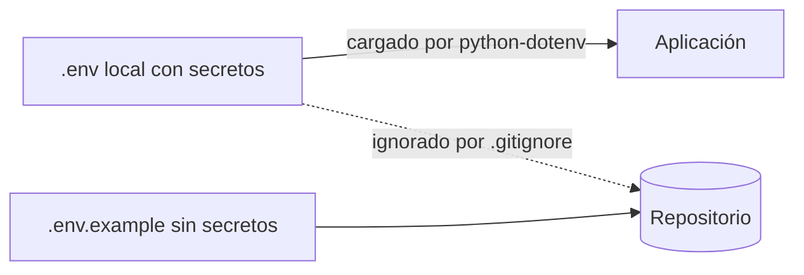

# Resumen: Manejo seguro de variables de entorno (.env)

| Campo | Valor |
| --- | --- |
| Curso / bloque | Cloud y EngX |
| Formato | Sesión extraordinaria de 30 minutos con líderes técnicos |
| Tiempo de lectura | 5 min |

## 3 puntos clave

1. Las credenciales (contraseñas, URLs de base de datos, llaves de API) viven en variables de entorno, nunca escritas dentro del código.
2. En local se guardan en un archivo `.env` que está en `.gitignore`. En el repositorio solo se sube `.env.example`, con los nombres de las variables y valores falsos.
3. Si una credencial llegó a un repositorio público, hay que revocarla o rotarla de inmediato. Borrarla en un commit nuevo no basta, porque queda en el historial.

## 2 comandos principales

```bash
# Verifica que .env está ignorado (debe mostrar la regla de .gitignore)
git check-ignore -v .env
```

```bash
# Si .env ya estaba versionado, déjalo de rastrear sin borrarlo de tu equipo
git rm --cached .env
```

## 1 diagrama



## Errores frecuentes y dónde seguir

- Subir el `.env` en el primer commit: usa `git check-ignore` antes de `git add .`.
- Usar la misma credencial para pruebas y producción: crea una por entorno.
- Ver el micro-proyecto 1 para un ejemplo de lectura de `DATABASE_URL` con `python-dotenv`.
